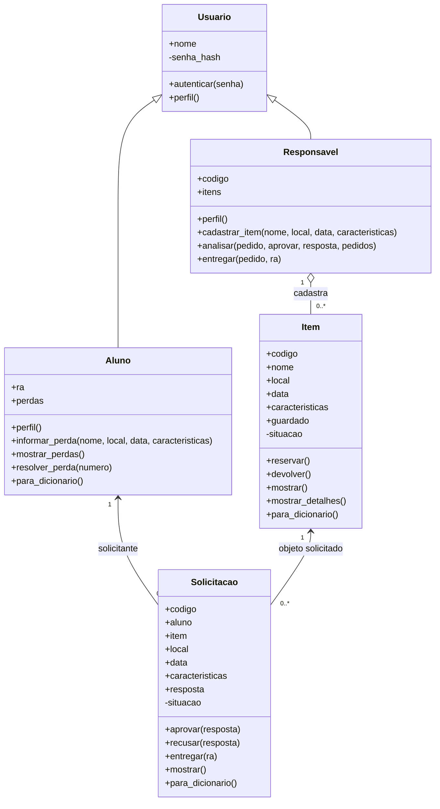

# Classes e conceitos de POO

As setas com triângulo representam herança. Aluno e Responsavel são tipos de Usuario. A secretaria guarda uma lista de itens. Cada solicitação se relaciona com um aluno e um item. Os avisos de perda são dicionários na lista perdas de cada aluno.

## Como explicar em sala

- **Classe** é o modelo usado para criar os objetos. Aluno é uma classe e a conta de Ana é um objeto.
- **Atributo** guarda um dado. nome e ra são atributos do aluno.
- **Método** é uma ação. informar_perda acrescenta um aviso à lista do aluno.
- **self** representa o objeto que está executando o método. self.nome é o nome desse objeto.
- **Construtor** é o método __init__, que prepara o objeto quando ele é criado.
- **Herança** aparece em Aluno(Usuario) e Responsavel(Usuario). Ambos recebem autenticar de Usuario.
- **super().__init__** executa o construtor de Usuario e prepara nome e senha protegida.
- **Sobrescrita** aparece em perfil. Cada classe filha define sua própria versão desse método.
- **Polimorfismo** aparece na função receber_usuario em main.py. Ela chama usuario.perfil() tanto para um aluno quanto para um responsável e recebe respostas diferentes.
- **Encapsulamento** aparece em __senha_hash e __situacao. A propriedade com @property permite consultar esses valores. A situação muda pelos métodos que verificam as regras. O prefixo __ protege contra alterações acidentais pelo uso comum da classe.
- **Abstração** permite chamar pedido.aprovar(resposta) sem repetir no menu as etapas de reservar o item e mudar o pedido.
- **Colaboração** aparece quando Responsavel chama Solicitacao.aprovar e o pedido chama Item.reservar.
- **Persistência** usa para_dicionario para preparar os registros e main.py para gravar o JSON. Ao carregar, RA e código recuperam os relacionamentos entre objetos.

## Ordem sugerida de leitura

Leia usuario.py, aluno.py, item.py, solicitacao.py e responsavel.py. Depois acompanhe em main.py um cadastro, um login, um pedido, uma aprovação e uma entrega. As funções salvar e carregar ficam no início de main.py, conforme a organização escolhida para o projeto.

O método resolver_perda altera a situação de um aviso da lista do próprio aluno para resolvida. O aviso permanece no histórico, e a lista de objetos procurados exibe somente os avisos em aberto.
